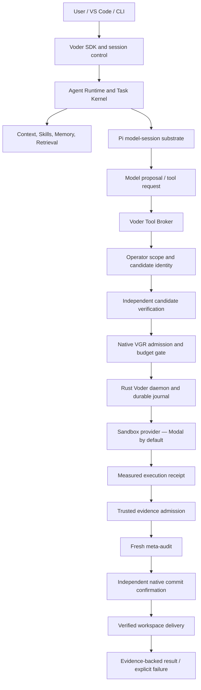

# Voder

**A verifiable coding agent built around externally governed execution.**

Voder is an open-source coding-agent system developed by the **VeriLoop Team**. It combines a reusable model-session substrate with a host-controlled tool surface and a native Rust governance layer. Its central design principle is simple:

> **A model may propose a change; it cannot authorize that change to become persistent state.**

Voder explores this separation through **VeriLoop-Governed Recurrence (VGR)**: proposal generation and state-acceptance authority are separated, and consequential transitions are gated by independently checked evidence.

Voder is also a research project exploring engineering foundations for safer autonomous and potentially superintelligent agents. It is **not an artificial superintelligence (ASI)**, does not claim to have achieved AGI or ASI, and does not establish a general guarantee against system-level risk.

<p align="center">
  <a href="#overview">Overview</a> ·
  <a href="#architecture">Architecture</a> ·
  <a href="#veriloop-governed-recurrence-vgr">VGR</a> ·
  <a href="#installation">Installation</a> ·
  <a href="#configuration">Configuration</a> ·
  <a href="#usage">Usage</a> ·
  <a href="#evaluation">Evaluation</a> ·
  <a href="#license">License</a>
</p>

---

## Project links

| Resource | Link |
|---|---|
| VS Code Marketplace | [Voder — VeriLoop's coding agent](https://marketplace.visualstudio.com/items?itemName=veriloop.voder-vscode) |
| Current Marketplace release | **0.1.47** |
| Technical report (PDF) | **Pending publication** |
| Technical report (LaTeX source) | **Pending publication** |
| Benchmark evidence bundle | **Pending publication** |
| Interactive 3D demonstrations | **Pending publication** |
| Release notes | **Pending publication** |
| Security policy | **Pending publication** |

Links marked *Pending publication* are intentional placeholders and will be replaced with permanent URLs when the corresponding artifacts are published.

## Overview

Most coding agents place the model at the center of an execution loop: the model proposes a tool call, the runtime executes it, and the result is returned to the model. This is an effective interaction pattern, but it leaves an important systems question: **what independently determines whether a proposed effect is allowed to become persistent state?**

Voder addresses that question at the harness boundary. It does not treat a model response, a tool's success message, or a remembered validation result as authorization. Instead, it binds a proposed change to an operator-approved scope and source state, validates the exact candidate, dispatches it through a native governance path, admits trusted observations, independently confirms commitment, and verifies the final destination bytes.

The result is an evidence-governed coding workflow in which generation, execution, acceptance, and delivery are distinct operations with distinct authority.

### Design objectives

- **Separate proposal from authority.** Model output is an inert proposal until host and native governance checks authorize the relevant transition.
- **Bind verification to exact bytes.** Candidate identity includes the target path, original preimage digest, and replacement content.
- **Make evidence authoritative.** Trusted validator execution and native receipts—not model-authored PASS claims—determine evidence admission.
- **Fence uncertainty.** A timeout or broken connection after dispatch does not prove that an effect did not occur and does not automatically authorize replay.
- **Verify delivery independently.** Native commitment, private artifact delivery, publication to the original workspace, and a Git commit are distinct events.
- **Control resource use prospectively.** Execution budgets are reserved before dispatch and settled against measured usage.
- **Keep context bounded and attributable.** Historical dialogue is selected on demand; recalled context cannot restore old execution permission.
- **Expose replaceable infrastructure.** Model providers and sandbox providers are explicit integration boundaries rather than hidden assumptions.

### What Voder is—and is not

| Voder is | Voder is not |
|---|---|
| A coding-agent harness with a native evidence-governance path | A foundation model or model-training project |
| A system that separates model proposals from state-acceptance authority | A claim that model-generated reasoning is itself a safety mechanism |
| A software-engineering platform with VS Code integration | A guarantee that every task or generated artifact is correct |
| An experimental control substrate relevant to safe-agent research | An implemented ASI system or proof of system-level safety |
| Extensible through explicit provider and adapter interfaces | A promise that arbitrary APIs, model protocols, or sandbox backends work without an adapter |

## Architecture

Voder separates the model interaction layer from the components that own scope, execution, evidence, and persistence.



### Responsibility boundaries

| Layer | Primary responsibility | Authority boundary |
|---|---|---|
| VS Code / CLI | User interaction, task submission, approval presentation, status and evidence views | Does not independently authorize native commitment |
| Voder SDK | Session lifecycle, event transport, cancellation, durable control state and recovery coordination | A host checkpoint is not a native commit receipt |
| Agent Runtime | Task orchestration, context assembly, model-session construction and next-action scheduling | Model proposals remain non-authoritative |
| Pi integration | Reusable model-session, streaming and context-compaction facilities | Ambient tools are disabled; Voder supplies the approved tool surface |
| Tool Broker | Exclusive host-side route for consequential tool execution | Rejects calls outside the approved scope and action identity |
| Candidate verifier | Checks exact candidate bytes, source preimages, pinned checks and isolated execution results | A PASS is necessary for the relevant path, but is not a native execution permit |
| Rust VGR Core | Contracts, action identity, evidence rules, obligation state and budget invariants | Owns native governance decisions |
| Rust Runtime | Sandbox execution, process control, artifact capture, workspace measurement and rollback primitives | Produces observations; does not invent acceptance authority |
| Rust daemon / Protocol | Durable state transitions, journal integrity, typed requests and replay | A durable dispatch record is distinct from a final commit |
| Sandbox provider | Executes the authorized validation workload and returns a structured receipt | Provider output is untrusted until independently checked |
| Delivery layer | Rechecks source preimages and final bytes before writing to the destination | Successful native commitment alone is not workspace delivery |

### Source layout

The source tree is organized around explicit build and runtime boundaries:

```text
.
├── Cargo.toml
├── crates/
│   ├── voder-core/          # Native contracts, decisions, evidence, budgets
│   ├── voder-runtime/       # Processes, sandboxes, artifacts, validators, rollback
│   ├── voder-protocol/      # Typed protocol envelopes, commands and events
│   └── voderd/              # Durable daemon, journal and native state transitions
├── packages/
│   ├── voder-providers/     # Provider-neutral model API contracts
│   ├── voder-provider-cloud/ # Managed cloud API provider
│   ├── voder-provider-open/ # Self-hosted inference endpoint provider
│   ├── voder-sandbox-modal/ # Modal sandbox provider and plugin contract
│   └── voder-cli/           # CLI and provider integration
└── voder-agent/
    ├── packages/
    │   ├── voder-agent-core/    # Kernel, broker, model host and task policies
    │   ├── voder-sdk/           # Session control and verified-delivery workflows
    │   ├── voder-native-bridge/ # Trusted gateway and commit verification bridge
    │   ├── voder-vscode/        # VS Code extension and user interface
    │   ├── voder-memory/        # Project and dialogue memory
    │   ├── voder-search/        # Configurable evidence retrieval
    │   ├── voder-context/       # Policies and task context
    │   ├── voder-skills/        # Skills registry and selection
    │   └── voder-tools/         # Host tools and adapters
    ├── plugins/
    ├── config/
    └── engine/
        └── voder-agent-engine/  # Pi upstream engine and retained attribution
```

The root Cargo workspace and the gateway Cargo workspace are separate build roots. The root npm workspace is not a one-command build of the complete product. See [Development](#development) for the verified build boundaries.

## VeriLoop-Governed Recurrence (VGR)

### Core principle: proposal generation is not acceptance authority

VGR is the governance mechanism that separates a model's ability to generate or revise a proposal from the authority to make that proposal persistent.

The model can:
- inspect permitted context;
- propose candidate source changes;
- request approved tools;
- interpret validator output;
- revise a candidate after a failure.

The model cannot, by producing text or a tool response:
- enlarge the operator-approved target scope;
- manufacture a trusted validator receipt;
- mark its own candidate as natively committed;
- convert an unknown execution outcome into permission to retry;
- bypass independent commit confirmation;
- declare workspace delivery without destination-specific verification.

This is an enforced runtime and native-state boundary, not a prompt-only convention.

### From VeriLoop E2 to a coding-agent harness

VGR carries an evidence-governed acceptance principle from VeriLoop's E2 framework into the software-execution harness.

In E2, a candidate rank vector is accepted only when it is no worse in every protected coordinate and strictly better in at least one:

\[
\boldsymbol r'_t \prec_{\mathrm P} \boldsymbol r_t
\iff
\left(\forall j,\ r'_{t,j}\le r_{t,j}\right)
\land
\left(\exists j,\ r'_{t,j}<r_{t,j}\right).
\]

Here, \(\boldsymbol r_t\) is the incumbent protected-rank vector and \(\boldsymbol r'_t\) is the candidate vector. The external acceptance decision supplies the retention label; the proposer does not decide whether its own output qualifies.

Voder transfers the **external acceptance and persistence boundary**, not E2's rank-descent rule as a universal measure of software quality. A repository edit is an observable effect, so the harness governs candidate bytes, execution identity, trusted evidence, native commitment and final delivery. The current gateway closes a pinned validator-success obligation; it does not claim to evaluate arbitrary natural-language requirements or a general semantic progress vector.

### The VGR execution path

A consequential coding task proceeds through distinct, identity-bound stages:

1. **Task admission.** The host identifies the workspace, task, operator-approved targets and applicable acceptance conditions.
2. **Scope preparation.** The host pins target paths and source preimages. Preparation of a candidate workspace is separate from accepting a model-proposed change.
3. **Proposal generation.** The model returns candidate edits. These edits are inert data, not workspace writes.
4. **Exact candidate verification.** The verifier checks the candidate against the pinned source state, approved paths, configured command and independent checkout.
5. **Native preparation.** Rust Core validates the frozen contract, action identity, reservation and required approval.
6. **Durable dispatch.** The daemon records the authorization transition before the Runtime may execute the action.
7. **Sandbox execution.** The configured backend executes the authorized workload and produces measured output and a structured receipt.
8. **Budget settlement.** The native ledger settles measured resource use against the reservation.
9. **Trusted evidence admission.** The daemon independently executes the pinned validator, checks the observation and admits a typed receipt.
10. **Fresh meta-audit.** Hard requirements and validator bindings are rechecked against the current native context and unchanged workspace.
11. **Independent commit confirmation.** A separate read-only observer reconstructs the durable native state and confirms the exact final commit identity.
12. **Verified delivery.** The destination is locked and rechecked; source preimages, candidate bytes and final hashes must match before delivery is recorded.

A failure at any stage stops advancement at that boundary. An observation is not a commit; a commit is not delivery; and a user-interface success message is not a substitute for either.

### Key formal mechanisms

#### 1. Exact candidate identity

For a single-file proposal \(p=(r,o,x)\), where \(r\) is the relative target path, \(o\) is the expected original SHA-256 digest, and \(x\) is the replacement text, Voder binds the candidate to:

\[
d(p)=H\!\left(\operatorname{UTF8}
\left(\operatorname{JS}([r,o,x])\right)\right).
\]

The verifier also requires the ordered target paths to equal the operator-approved scope and checks that each live source file still hashes to its pinned preimage. Batch candidates use a separately defined ordered encoding and enforce distinct, sorted targets.

This prevents a verification result for one file, one starting state or one candidate from silently authorizing different bytes.

#### 2. Prospective resource reservation

VGR tracks resource capacity as vectors rather than treating execution cost as an afterthought:

\[
\boldsymbol a=\boldsymbol t-\boldsymbol s-\boldsymbol r,
\qquad
\boldsymbol s+\boldsymbol r\preceq\boldsymbol t.
\]

The eight coordinates are steps, tokens, model calls, tool calls, wall time, policy-risk microunits, active-context tokens and API cost in millionths of a US dollar. A reservation is made before dispatch; settlement replaces the reservation with measured usage; cancellation releases only work that has not been dispatched.

The risk coordinate is a policy score, **not a probability of harm**. The generic ledger supports eight dimensions, but the current gateway meters only the dimensions for which its execution adapter supplies measurements.

#### 3. Durable dispatch and replay fencing

The native journal is append-only and hash-chained. For event sequence \(j\), event body \(b_j\), predecessor hash \(h_{j-1}\), and SHA-256 function \(H\):

\[
h_j =
H\!\left(
\texttt{voder-ledger-v1}\Vert
\texttt{\textbackslash n}\Vert
\operatorname{dec}(j)\Vert
\texttt{\textbackslash n}\Vert
h_{j-1}\Vert
\texttt{\textbackslash n}\Vert
\operatorname{UTF8}(\operatorname{RustJSON}(b_j))
\right).
\]

The dispatch gate checks a valid contiguous journal chain, unique preparation and dispatch records, and an exact match to the session, run, action, reservation, contract and workspace identities.

This is an integrity and replay-fencing mechanism under the trusted-host assumptions. It is not a distributed exactly-once theorem and does not protect against a malicious host capable of rewriting the complete journal.

#### 4. Trusted evidence admission

A trusted evidence receipt is admitted only when its identities, frozen contract, workspace, trusted observation, validator binding and evidence-use constraints all match:

\[
G_{\mathrm{admit}}(e)
=
I_e\land C_e\land S_e\land T_e\land V_e\land D_e.
\]

A model-supplied PASS string, JSON field or receipt digest is not a trusted observation. The native bridge independently executes the pinned validator through the configured sandbox, verifies the output and workspace, and then asks Core to admit the typed receipt.

Evidence admission is applied to private trial state. The journal append and required persistence must succeed before the trial ledger and obligation state become the published native state.

#### 5. Fresh meta-audit and separate delivery

Before final commitment, VGR rechecks the current context and hard obligations, runs fresh pinned validators, and requires the measured workspace to remain unchanged:

\[
G_{\mathrm{audit}}
=
G_{\mathrm{context}}
\land G_{\mathrm{hard}}
\land
\bigwedge_{r\in\mathcal R_{\mathrm h}}
\bigwedge_{v\in\mathcal V(r)}
\operatorname{FreshPass}(v)
\land
[W_{\mathrm{after}}=W_{\mathrm{before}}].
\]

The final native commit is persisted separately and independently observed after the writer releases its lock. The SDK then performs destination-specific delivery checks.

For an ordinary evidence-mode delivery request \(K\) and candidate \(P\), the implemented normal path enforces the following implication under its trusted execution and persistence assumptions:

\[
\operatorname{DurableDelivery}(K)
\Longrightarrow
\operatorname{CPass}(P)
\land
\operatorname{Pinned}(K)
\land
G_{\mathrm{confirm}}
\land
\operatorname{Bytes}(K).
\]

This is a statement about the specified normal delivery path and its configured obligations—not a proof that the obligations capture every possible defect or harmful program behavior.

### What VGR protects

| Failure pathway | Enforced mechanism | Intended property |
|---|---|---|
| Candidate substitution | Exact path, preimage and replacement identity | A check cannot silently authorize different bytes |
| Scope expansion | Operator-pinned ordered path set | Model output cannot enlarge write scope |
| Model-authored success | Trusted validator execution and typed evidence admission | A model claim cannot become authoritative evidence |
| Reused or duplicated dispatch | Durable action identity and journal checks | An attempted action cannot gain a fresh permit by changing its narrative |
| Uncertain remote outcome | Persistent attempt identity and reconciliation | Timeout does not automatically authorize replay |
| Stale or altered workspace | Fresh measurement and preimage checks | Evidence remains bound to the measured workspace |
| False completion claim | Independent observer and destination hash checks | Delivery requires verified native state and final bytes |

## Model and provider configuration

Voder separates model-session execution from effect authorization. A model provider supplies proposals; it does not own the VGR commit gate.

### Cloud model APIs

The cloud provider package includes presets for:

- OpenAI
- Anthropic
- Google Gemini
- Moonshot / Kimi
- Zhipu / GLM
- DeepSeek
- xAI / Grok
- Alibaba Qwen
- OpenRouter
- Custom HTTPS-compatible endpoints

The provider adapter supports the protocol declared by the configured endpoint, including OpenAI-compatible Chat Completions, OpenAI Responses and Anthropic Messages where implemented. A vendor name or model label does not guarantee protocol compatibility: the selected model ID must be the exact identifier accepted by the provider account.

### Self-hosted model weights

Voder can be connected to model weights that are **already deployed behind an inference server**. The supported self-hosted provider package is designed for OpenAI-compatible endpoints exposed by:

- vLLM
- SGLang
- Ollama
- llama.cpp
- Other compatible inference gateways

Voder connects to the server endpoint and model identifier. It does **not** download checkpoint files, provision GPU instances, start an inference server, or guarantee that a particular model fits a particular GPU.

A typical self-hosted deployment needs:

1. Model weights already placed on a server you control.
2. An inference runtime installed and started on that server.
3. A reachable API endpoint, preferably HTTPS.
4. An exact model identifier exposed by that endpoint.
5. Tool/function-calling support compatible with the selected adapter.
6. An API token if the endpoint is authenticated.

The provider package exposes these configuration fields:

| Variable | Purpose |
|---|---|
| `VODER_OPEN_RUNTIME` | `vllm`, `sglang`, `ollama`, `llamacpp` or `compatible` |
| `VODER_OPEN_ENDPOINT` | OpenAI-compatible API base URL |
| `VODER_OPEN_MODEL` | Exact model ID exposed by the inference server |
| `VODER_OPEN_API_KEY` | Optional endpoint credential, when required |
| `VODER_OPEN_TIMEOUT_MS` | Request timeout; default 60,000 ms |
| `VODER_OPEN_MAX_OUTPUT_TOKENS` | Maximum output budget; default 1,024 |
| `VODER_OPEN_ALLOW_LOOPBACK_HTTP` | Explicit opt-in for a loopback HTTP endpoint |

Example:

```bash
VODER_OPEN_RUNTIME=vllm
VODER_OPEN_ENDPOINT=https://inference.example.com/v1
VODER_OPEN_MODEL=your-served-model-id
VODER_OPEN_API_KEY=YOUR_PRIVATE_ENDPOINT_TOKEN
VODER_OPEN_TIMEOUT_MS=60000
VODER_OPEN_MAX_OUTPUT_TOKENS=4096
```

This is an endpoint configuration example, not a command to install or launch vLLM. The self-hosted provider must be installed and selected as the active provider plugin in the deployment. Do not point Voder directly at a `.safetensors` file or a model directory.

### Model API configuration

The current VS Code extension exposes **Voder: Configure Model API** and the combined first-run command **Voder: Configure Models, Modal and Search**.

The source-side model configuration uses a private user-level file:

`~/.config/voder/model-provider.json`

The file is read from the home directory of the **workspace extension host**. With Remote SSH or WSL, that means the remote Linux/WSL host—not necessarily the computer running the VS Code window.

Supported fields:

| Field | Required | Meaning |
|---|---:|---|
| `VODER_MODEL_ID` | Yes | Exact provider model ID |
| `VODER_MODEL_API_KEY` | Yes for authenticated API providers | Provider credential |
| `VODER_MODEL_VENDOR` | Recommended | `openai`, `anthropic`, `gemini`, `kimi`, `glm`, `deepseek`, `grok`, `qwen`, `openrouter` or `custom` |
| `VODER_MODEL_PROTOCOL` | Provider-dependent | `openai-completions`, `openai-responses` or `anthropic-messages` |
| `VODER_MODEL_ENDPOINT` | Required for `custom` | HTTPS API base URL |
| `VODER_MODEL_CONTEXT_WINDOW` | Recommended | Configured context-window limit |
| `VODER_MODEL_MAX_TOKENS` | Recommended | Configured maximum output tokens |
| `VODER_MODEL_INPUT` | Optional | `text` or `text,image` |

Example reference profile:

```json
{
  "VODER_MODEL_ID": "deepseek-flash",
  "VODER_MODEL_VENDOR": "deepseek",
  "VODER_MODEL_PROTOCOL": "openai-completions",
  "VODER_MODEL_ENDPOINT": "https://api.deepseek.com/v1",
  "VODER_MODEL_API_KEY": "REPLACE_WITH_YOUR_PRIVATE_KEY",
  "VODER_MODEL_CONTEXT_WINDOW": "1000000",
  "VODER_MODEL_MAX_TOKENS": "SET_TO_YOUR_PROVIDER_LIMIT"
}
```

The model ID and limits above are a reference configuration captured in the team's environment inventory. They are not universal defaults for all accounts or models. Use the actual model ID and limits provided by your inference endpoint.

On Linux, create the directory and restrict the file permissions:

```bash
mkdir -p ~/.config/voder
chmod 700 ~/.config/voder
chmod 600 ~/.config/voder/model-provider.json
```

The configuration loader rejects symlinks, files with group/other permissions, unknown keys and malformed values. Never paste API keys into Voder Chat, commit them to Git, or place them in a public workspace file.

### Search provider configuration

Search is an optional capability and is configured independently from model inference. The source includes presets for Brave, Tavily, Serper, SerpAPI, BigModel, DeepSeek and SearXNG, plus a custom HTTP request/response mapping.

The guided setup command is **Voder: Configure Models, Modal and Search**. The source-level configuration reference is:

`voder-agent/packages/voder-search/CONFIGURATION.md`

Search credentials and endpoint configuration belong in private user-level configuration, not in the repository. Configuring multiple providers does not mean every task calls every provider; the search router applies a bounded request budget and duplicate/failure controls.

## Sandbox configuration

### Modal is the default sandbox provider

The current Voder sandbox integration uses **Modal** as its default remote execution backend. The model provider and sandbox provider are independent: changing the model does not change the sandbox, and changing the sandbox does not change the model's authority.

The Modal adapter:
- creates a remote sandbox using an explicitly selected app and image;
- pins the image by digest in the native profile;
- blocks sandbox network access by default in the current Modal driver;
- transfers source inputs with integrity checks;
- captures stdout and stderr under explicit output limits;
- returns a structured receipt bound to the run and action IDs;
- distinguishes remote execution failure from transport failure;
- does not automatically replay arbitrary state-changing commands after an uncertain result.

### Modal credentials

Use **Voder: Configure Models, Modal and Search** where available. The source-side native environment can also load Modal credentials from a private shell loader at:

`~/.config/voder/load-modal.sh`

Example:

```bash
mkdir -p ~/.config/voder
chmod 700 ~/.config/voder
umask 077

cat > ~/.config/voder/load-modal.sh <<'EOF'
export MODAL_TOKEN_ID="YOUR_MODAL_TOKEN_ID"
export MODAL_TOKEN_SECRET="YOUR_MODAL_TOKEN_SECRET"
export VODER_MODAL_APP="your-modal-app-name"
EOF

chmod 600 ~/.config/voder/load-modal.sh
```

Replace the example values with credentials created in your own Modal account. The app name must satisfy Modal/Voder's configured naming constraints. The loader must be a regular file owned by the active user and must not be group- or world-writable.

Do not commit this file or copy its contents into a prompt. Voder loads the credentials into the child process environment; they are not model instructions.

### Sandbox resource contract

The sandbox request binds the workspace, absolute program path, argument vector, required input files, timeout, memory, CPU, output cap, run ID and action ID.

The current provider contract validates the following upper bounds:

| Field | Contract range |
|---|---:|
| Task timeout | 100 ms – 3,600,000 ms |
| Sandbox setup budget | 300,000 ms – 1,800,000 ms |
| Memory | 128 – 32,768 MiB |
| CPU | 0.25 – 16 |
| Combined captured output | 1 byte – 16 MiB |
| Required input files | At most 256 |

These are schema limits, not recommended settings for every workload. Actual task values are selected by the configured execution policy.

### Replacing Modal with another sandbox

Modal is the built-in default, not a conceptual requirement of VGR. The sandbox layer has a provider-neutral plugin contract. A custom provider implements the sandbox task/receipt interface and must be explicitly registered as an operator-managed provider.

A replacement should preserve at least:

- exact run/action identity;
- input manifest and digest verification;
- bounded execution time, memory, CPU and output;
- explicit network policy;
- measured exit status and captured-output digests;
- receipt integrity and provider identity;
- clear treatment of uncertain remote outcomes;
- no automatic replay of arbitrary state-changing actions.

VGR admission and delivery remain in Rust Core and the native gateway. A custom sandbox provider must not be allowed to issue its own acceptance or commit decision.

We encourage users to build providers for their own infrastructure—private Kubernetes clusters, dedicated compute, on-premise runners or other controlled environments—and to contribute improvements that preserve these invariants.

## VS Code 0.1.47

### Release information

| Item | Value |
|---|---|
| Extension ID | `veriloop.voder-vscode` |
| Display name | Voder – VeriLoop's coding agent |
| Current Marketplace version | **0.1.47** |
| VS Code engine | `^1.105.0` |
| Extension kind | `workspace` |
| Main entry | `src/host-entry.cjs` |

Because the extension is a workspace extension, its runtime, paths, model configuration and sandbox credentials belong to the workspace extension host. In Remote SSH or WSL, configure the remote environment.

> **Release/source distinction:** The Marketplace extension is published as **0.1.47**. The supplied source archive's embedded `voder-agent/packages/voder-vscode/package.json` identifies **0.1.45** and `src/extension.cjs`, while the 0.1.47 Marketplace manifest identifies `src/host-entry.cjs`. This README therefore uses the 0.1.47 manifest for Marketplace settings and commands, and the supplied source snapshot plus technical report for the documented architecture. It does **not** claim that the supplied archive is a reproducible source build of the 0.1.47 VSIX. Publish a matching release tag and build attestation before making that claim.

### Requirements

- Visual Studio Code 1.105.0 or newer.
- Node.js 22.19.0 or newer on the workspace extension host.
- A trusted local or remote project folder.
- A configured model provider.
- For native verified execution: a valid VGR gateway profile, the required native binaries and a configured sandbox backend.
- For the default remote sandbox: a valid Modal account, app and credentials.

The native profile in the supplied source snapshot is Linux-oriented. When using Remote SSH, install and configure the extension on the remote Linux host and use paths that exist on that host.

### Install

1. Open VS Code.
2. Open **Extensions** (`Ctrl+Shift+X` / `Cmd+Shift+X`).
3. Search for `@id:veriloop.voder-vscode`.
4. Install **Voder – VeriLoop's coding agent**.
5. If the project is opened through Remote SSH or WSL, ensure the extension is installed on the **remote workspace host**.
6. Reload the VS Code window.
7. Open a trusted project folder.
8. Open the Command Palette and run **Voder: Configure Models, Modal and Search**.
9. Configure the model provider and Modal connection.
10. Open **Voder: Open Chat** and confirm the session status before submitting a write task.

### Extension settings

The 0.1.47 extension manifest declares the following seven settings:

| Setting | Type | Default | Description |
|---|---|---|---|
| `voder.agentRoot` | string | `""` | Optional Voder source root. Auto-detects `voder-agent` in the workspace or `VODER_AGENT_ROOT` on the remote host. |
| `voder.nodeExecutable` | string | `node` | Node executable used for the SDK/CLI RPC process. Requires Node 22.19+. |
| `voder.mode` | enum | `native` | `native` requires trusted VGR gateway configuration. `draft` is explicitly unverified, text-only mode. |
| `voder.nativeGatewayConfig` | string | `""` | Path to the private native VGR gateway configuration. If empty, the extension uses `VODER_NATIVE_GATEWAY_CONFIG` from the remote extension host. |
| `voder.autoBindTerminals` | boolean | `true` | Creates a distinct idle Voder session for each IDE terminal in unambiguous workspaces. It does not execute commands automatically. |
| `voder.showEventMetadata` | boolean | `true` | Displays allowlisted VGR/SDK event metadata, not task text or raw tool payloads. |
| `voder.autoRecovery` | boolean | `false` | Explicit opt-in to guarded recovery after a crash. Rust must independently confirm rollback; committed or unknown actions are never automatically replayed. |

Example `settings.json`:

```json
{
  "voder.agentRoot": "/absolute/path/to/voder-agent",
  "voder.nodeExecutable": "/absolute/path/to/node",
  "voder.mode": "native",
  "voder.nativeGatewayConfig": "/absolute/path/to/private/gateway.json",
  "voder.autoBindTerminals": true,
  "voder.showEventMetadata": true,
  "voder.autoRecovery": false
}
```

All paths in this example are placeholders. Use paths on the workspace extension host. Keep the gateway configuration private and do not place credentials in workspace settings.

### `native` and `draft` modes

| Mode | Behavior | Delivery status |
|---|---|---|
| `native` | Uses the configured trusted VGR gateway and native execution path | A task is complete only after the native and destination checks required by the selected profile succeed |
| `draft` | Text-only model interaction without native verified writes | Output is explicitly **UNVERIFIED**; it is not a verified code delivery |

Do not interpret a fluent draft response as a completed code change. Use `native` only after the trusted gateway, model and sandbox prerequisites have been configured.

### Command reference

The 0.1.47 manifest exposes these commands:

| Command | Purpose |
|---|---|
| Voder: Preview Current File | Preview the current file |
| Voder: Configure Model API | Configure the model API provider |
| Voder: Execution Settings | Configure execution mode and related settings |
| Voder: Open Chat | Open the Voder Chat view |
| Voder: New Session Terminal | Create a new Voder session terminal |
| Voder: Bind Active Terminal to Session | Bind the active terminal to a Voder session |
| Voder: Submit Task | Submit a task |
| Voder: Submit Task With Selected Code | Submit a task with the current selection |
| Voder: Show Session Status | Inspect current session status |
| Voder: Show Evidence Events | Inspect allowlisted evidence and control events |
| Voder: Cancel Active Task | Request task cancellation |
| Voder: Inspect Verified Session Diff | Inspect the verified diff |
| Voder: Show Editor Diagnostics | Show editor diagnostics |
| Voder: Export Session Metadata | Export session metadata |
| Voder: Reconnect Control Plane | Reconnect to the control plane |
| Voder: Browse Sessions | Browse available sessions |
| Voder: Inspect Historical Recovery (Read Only) | Inspect historical recovery state without changing it |
| Voder: Retry VGR-Guarded Recovery | Retry an explicitly guarded recovery operation |
| Voder: Repair From Failed Validation | Continue from failed validation evidence |
| Voder: Inspect Selected Files (Passive Checks) | Run passive checks on selected files |
| Voder: Restore Project Session Evidence (Read Only) | Restore/read project session evidence |
| Voder: Inspect Generated Project Tools | Inspect tools in a generated project |
| Voder: Inspect Generated Project Runtime | Inspect a generated project's runtime |
| Voder: Run Selected Python Tests in Sandbox | Run selected Python checks in the sandbox |
| Voder: Add File to Context | Add a file as task context |
| Voder: Add Selection to Context | Add selected code as task context |
| Voder: Configure Vision Model | Configure the vision model |
| Voder: File Input Diagnostics | Diagnose file input handling |
| Voder: Extract Archive | Extract a supported archive |
| Voder: Configure Models, Modal and Search | Open the combined first-run configuration workflow |

## Usage

### 1. Configure the environment once

Run **Voder: Configure Models, Modal and Search** from the Command Palette.

Configure:
- the model provider, exact model ID and API credential;
- the context and output limits supported by that model;
- Modal credentials and app name, if using the default sandbox;
- an optional search provider, if retrieval is required.

For Remote SSH or WSL, perform this setup in the remote environment. A model key configured on the local desktop is not automatically available to the remote extension host.

### 2. Open a project

Open the repository or project folder you want Voder to work on. Use a trusted workspace. Check that:
- the intended repository is open;
- the source files are in the expected state;
- Git status is understood before a consequential task;
- required dependencies and test commands are available;
- the configured Voder source root resolves correctly.

### 3. Start a session

Use **Voder: Open Chat** or **Voder: New Session Terminal**.

A session is an execution context, not a blanket permission to modify the repository. Each task must still pass the applicable scope, approval, verification and delivery gates.

### 4. Provide a precise task

A high-quality task request should specify:

- the intended outcome;
- the permitted target files or directories;
- constraints that must not change;
- acceptance criteria;
- the exact tests or checks to run;
- any required output or delivery format.

Example:

```text
Inspect src/parser.ts and its existing tests.

Fix the handling of escaped delimiters without changing the public API.
Keep the patch limited to src/parser.ts and the corresponding parser tests.
Add regression coverage for the failing input.
Run the repository's parser test suite and report the exact command and result.
Do not modify unrelated files or update dependencies.
```

The model may inspect additional context where the task policy permits it, but write scope remains controlled by the operator-approved task and native gateway.

### 5. Add relevant context

Use:
- **Voder: Add File to Context** for a relevant file;
- **Voder: Add Selection to Context** for a selected code region;
- **Voder: Extract Archive** for a supported archive that must be inspected;
- **Voder: Configure Vision Model** when the task requires visual inspection.

Only add material relevant to the task. Context is input to reasoning, not an execution permit.

### 6. Review approval requests

Before approving a consequential task, check:
- the workspace and target paths;
- the intended change scope;
- the validator or test command;
- the model and sandbox provider;
- expected model/API and sandbox charges;
- any external side effect.

Do not approve a broader scope merely because the model proposes it. If the requested scope is wrong, cancel and resubmit with the correct scope.

### 7. Follow execution and evidence

Use:
- **Voder: Show Session Status** for task state;
- **Voder: Show Evidence Events** for the allowlisted control/evidence trail;
- **Voder: Show Editor Diagnostics** for diagnostics;
- **Voder: Inspect Verified Session Diff** for the verified change;
- **Voder: Browse Sessions** for session history.

A validator PASS is one required observation, not by itself a delivery receipt. Wait for the native commit confirmation and the final destination checks.

### 8. Handle failures and uncertain outcomes correctly

- A failed validator should produce a repair path based on the observed failure.
- A timeout after dispatch is an **unknown outcome**, not proof that nothing ran.
- Do not manually replay a task whose native outcome is unknown.
- Use the recovery inspection and VGR-guarded recovery commands to reconcile the recorded state.
- Cancellation is not proof of rollback.
- A committed native action must not be repeated just to repair a later presentation or publication failure.

### 9. Verify delivery

Before treating a task as complete:
- inspect the final diff;
- confirm the expected files and hashes;
- inspect the evidence/status record;
- confirm that the destination delivery state is recorded;
- run any additional project-level checks that are outside the configured validator.

Voder reports failure or uncertainty explicitly rather than treating an incomplete execution as success.

## Evaluation

### Audited benchmark results

The following results are taken from the supplied Voder technical report's retained reward audit. All four runs are author-reported as using the **DeepSeek V4.1 Flash 1017 API**. A task counts as a confirmed pass only when a retained numeric `official_reward = 1` is present; each task is counted once, and the denominator is the complete suite size.

| Benchmark | Confirmed passes | Full suite | Score |
|---|---:|---:|---:|
| DeepSWE v1.1 | 89 | 113 | **78.8%** |
| Terminal-Bench 3.0 | 31 | 74 | **41.9%** |
| Terminal-Bench 4.0 | 30 | 66 | **45.5%** |
| SWE-Marathon | 9 | 20 | **45.0%** |

**Important evaluation qualifications**

- These are local audited counts from retained evaluator records, not accepted official leaderboard submissions.
- SWE-Marathon is a **reference-assisted internal control**. Its 45.0% result is not an unassisted model score and is not directly comparable with a standard unassisted leaderboard entry.
- The report does not claim that these scores establish ASI capability or comprehensive safety.
- The report records the model configuration as author-reported; the retained reward audit does not include a complete per-task generation trace.

**Benchmark evidence:** [Pending publication — replace with the retained evidence bundle URL.]

### Engineering and control evidence

| Experiment | Reported result | Scope and interpretation |
|---|---:|---|
| Component verification | **318 / 318** | Node and Rust component assertions in the retained test record |
| Concurrency stress | **420 / 420** | Process executions across the specified stress cases; not 420 independent real-world tasks |
| SDK recovery battery | **11 / 11** | Controlled recovery fixtures, including refusal to replay committed or uncertain actions |
| Daemon restart checks | **3 / 3** | Acknowledged blocked-state persistence and replay after restart; not in-flight native-commit crash recovery |
| Synthetic context selection | **93.3%–98.7% estimated reduction** | Estimated token-volume reduction versus constructed full-history injection; not provider-billed savings |

The engineering results concern specific interfaces and fixtures. They should not be pooled into a single end-to-end reliability estimate. In particular, the daemon restart cases do not demonstrate crash recovery from every point inside an in-flight native commit.

### Interactive 3D demonstrations

The technical report describes five case-study categories backed by nine executable 3D demonstration files.

| Case study | Description | Demo |
|---|---|---|
| Cycling pelican | Procedural character geometry, articulated cycling motion and scene rendering | Pending |
| Reusable-booster recovery | Scripted booster approach, tower alignment, capture sequence and camera movement | Pending |
| Black-hole visualization | Shader-based accretion structure, camera and brightness controls | Pending |
| Wormhole exploration | Two-ended geometric surface with grid and cutaway controls | Pending |
| Interactive racing | Racing scene and state-coherence case study | Pending |

**3D demo gallery:** [Pending publication — replace with the demo gallery URL.]

These demonstrations document delivered interactive artifacts. A cinematic rendering is not a physical simulation certificate: the rocket case, for example, does not establish structural load transfer or physically controlled landing dynamics; the black-hole and wormhole scenes are visualizations, not validated relativistic simulations.

## Limitations and research boundaries

Voder's current results support a bounded engineering control argument. They do not close the broader research problem of safe recursive self-improvement.

The current system has important limitations:

1. **Obligation adequacy.** The current gateway closes a pinned validator-success obligation. A successful validator does not prove that the validator captures every substantive requirement.
2. **Trusted computing base.** The control argument assumes trusted host configuration, native binaries, adapters, validator registration and filesystem enforcement. Hash chains detect specified integrity failures; they do not defend against a malicious host that can rewrite the complete record.
3. **Effect-specific mediation.** The strongest implemented path concerns software files and the configured execution workflow. Other persistent effects require their own authorization, observation and rollback semantics.
4. **Crash coverage.** The retained daemon restart evidence covers acknowledged blocked state. Interruption during every phase of an actual in-flight native commit remains future work.
5. **Publication atomicity.** Multi-file publication is not claimed to be globally atomic. Partial publication failure is retained as failure/uncertainty rather than reported as successful delivery.
6. **Context-cost measurement.** Token reductions are estimated from synthetic histories. They do not establish billed-token savings or unchanged task quality under every context policy.
7. **Recursive self-modification.** VGR does not yet demonstrate that its governance invariants remain intact when an agent can modify the governance implementation, trusted binaries, deployment policy or its own acceptance rules.
8. **ASI boundary.** Voder has not implemented ASI and has not demonstrated a reduction in system-level risk.

The central research question remains whether acceptance authority can remain externally governed as proposal capability and the scope of possible effects increase.

## Development

### Runtime and build boundaries

The supplied source tree contains multiple build roots. Do not interpret a successful build of one package as a complete product build.

Core runtime requirements in the source include Node.js 22.19 or newer. The native components use Rust and Cargo. The Pi engine is retained as a separately structured upstream workspace.

### Native Rust builds

From the repository root:

```bash
cargo build --locked --release -p voderd \
  --target-dir .voder-build

cargo build --locked --release \
  --manifest-path voder-agent/crates/voder-gateway/Cargo.toml \
  --target-dir .voder-build
```

These commands build the two native roots identified by the source architecture. They are not a complete clean-machine installation recipe: model-provider configuration, the managed Node runtime, the Pi SDK dependencies, sandbox credentials and deployment profiles remain separate prerequisites.

### Agent-core, SDK and bridge tests

From `voder-agent/`:

```bash
node --test \
  packages/voder-agent-core/test/*.test.mjs \
  packages/voder-sdk/test/*.test.mjs \
  packages/voder-native-bridge/test/*.test.mjs
```

### Provider package

The root npm workspace builds the provider package under `packages/voder-providers`. That build is not a build of the complete Voder application or the Pi workspace.

### Contribution principles

Contributions should preserve the authority boundaries rather than merely increase the number of tools or model capabilities.

Before proposing a change:
- identify the owning layer and its trust boundary;
- state which persistent effect the change can cause;
- define the exact evidence needed to accept that effect;
- specify how uncertain outcomes are reconciled;
- preserve source identity and scope checks;
- include regression tests for both acceptance and rejection cases;
- distinguish implemented behavior from planned behavior.

For changes to native governance, include negative tests. A test suite that only demonstrates successful execution is insufficient for a component whose purpose is to reject unauthorized transitions.

## Attribution and upstream components

Voder is an original VeriLoop research and engineering project. Its native VGR governance logic, Rust Core/Runtime/daemon implementation, task-acceptance boundaries and Voder-specific integration are developed by the VeriLoop Team.

Voder also adapts and retains the **Pi coding-agent engine** as an upstream model-session substrate. The source tree identifies the initial Pi baseline as version 1.1.0, commit `abe508e1b89912adde45528136c3221eb69acdd7`. Pi's upstream license is MIT; its copyright notices and license must remain with redistributed upstream code. Voder's original governance contribution should not be confused with ownership of upstream Pi code.

Related upstream projects and documentation:

- [OpenAI Codex](https://github.com/openai/codex) — coding-agent CLI and sandbox/approval documentation.
- [Pi](https://github.com/earendil-works/pi) — reusable agent runtime, model API and coding-agent SDK.
- [DeepSeek Harness](https://github.com/deepseek-ai/deepseek-harness) — plugin-oriented harness architecture and subsystem documentation.

These projects are referenced as relevant engineering systems, not as Voder dependencies except where explicitly identified in the source and attribution records.

## Team and authorship

**Voder is developed by the VeriLoop Team.**

- **Technical Lead and Lead Developer:** **Libo Wang**
- **Core technical originator:** **Libo Wang**, original inventor of the VGR governance mechanism and principal architect of Voder's core technical design.
- **Research team:** VeriLoop
- **Laboratory:** Intelligent Robotics Laboratory
- **Institutional affiliation:** Tsinghua Shenzhen International Graduate School, Tsinghua University
- **Faculty advisor:** Professor Houde Liu

The affiliation identifies the team's research context and should not be interpreted as an institutional endorsement of every statement, release or deployment.

## License

### Recommendation: Apache License 2.0 for original Voder code

The recommended license for the original Voder implementation is **Apache License 2.0**.

It is a strong fit for a research-driven infrastructure project intended for broad developer and enterprise adoption because it provides:
- a permissive license for commercial and non-commercial use;
- an express patent license from contributors, subject to the license terms;
- clear requirements for preserving copyright, license and NOTICE information;
- a familiar contribution and redistribution framework for downstream organizations.

**This recommendation is subject to an intellectual-property ownership and authorization review before publication.** Because the project is developed within a university-affiliated laboratory, the team should confirm who owns or is authorized to license each original contribution under the applicable institutional, employment, funding and collaboration arrangements.

The repository also contains upstream and third-party components. A root Apache-2.0 license must apply only to code for which the project has the necessary rights. The Pi engine remains under its upstream MIT license, and other bundled components must retain their applicable licenses and notices. A `THIRD_PARTY_NOTICES` inventory should accompany the release.

The supplied source archive does not currently establish a complete root-level license declaration for every file. Do not treat this recommendation as permission to relicense upstream or third-party code.

---

**Voder — VeriLoop Team**  
*Evidence before acceptance. Governance beyond the model.*
