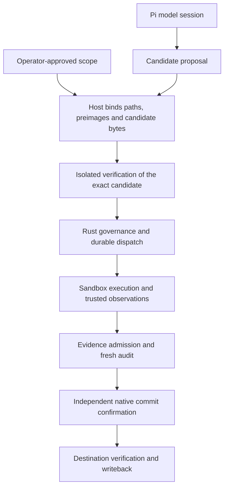

<p align="center">
  
</p>

<h1 align="center">Voder</h1>

<p align="center"><strong>A coding agent with independently governed writeback</strong></p>

<p align="center">
  <a href="https://marketplace.visualstudio.com/items?itemName=veriloop.voder-vscode"></a>
  <a href="https://openreview.net/forum?id=11hpVvFso1&amp;noteId=11hpVvFso1"></a>
  <a href="#interactive-3d-demos"></a>
  <a href="#benchmark-evidence"></a>
</p>

<p align="center">
  <a href="#install-in-vs-code">Install</a> ·
  <a href="#configure-voder">Configure</a> ·
  <a href="#how-vgr-works">How VGR works</a> ·
  <a href="#source-layout">Source layout</a> ·
  <a href="#contact">Contact</a>
</p>

Voder is a coding-agent harness developed by the **VeriLoop Team**. It uses a Pi-derived model-session engine for streaming and context management. Voder owns the tool surface, task scope and candidate verification, while a native Rust layer governs evidence admission and commitment.

**The model proposes a change. A separate execution path decides whether the exact change may become persistent.** We call this mechanism **VeriLoop-Governed Recurrence (VGR)**.

## Install in VS Code

**Marketplace release 0.1.47** · **VS Code 1.105.0 or later** · extension ID `veriloop.voder-vscode`.

1. Open **Extensions** in VS Code and search for `@id:veriloop.voder-vscode`.
2. Install **Voder – VeriLoop’s coding agent**. For a Remote SSH or WSL project, install Voder on the workspace host shown in the Extensions view.
3. Open a project folder you trust. Open the Command Palette with `Ctrl+Shift+P` on Windows/Linux or `Cmd+Shift+P` on macOS.
4. Run **Voder: Configure Models, Modal and Search**. Start with **1 · Primary model**.
5. Run **Voder: Open Chat**. For a first check, ask Voder to explain a named file and leave the project unchanged. Then configure Modal and test a small change with an explicit validation command.

You can also open the [Marketplace listing](https://marketplace.visualstudio.com/items?itemName=veriloop.voder-vscode) or install into the VS Code environment targeted by its CLI.

```bash
code --install-extension veriloop.voder-vscode
```

| Workspace host | Runtime packaged in 0.1.47 |
|---|---|
| Windows local | Windows x64 and ARM64 |
| macOS local | macOS 13+ x64 and ARM64 |
| Linux, including Remote SSH or WSL | Linux x64 |

The standard installation includes Node.js and native components. A custom source-runtime deployment needs Node.js 22.19 or later and the matching native binaries. Settings, private configuration files and paths belong to the workspace host. In Remote SSH, that is the remote machine.

## Configure Voder

### 1. Set the primary model

Open **Voder: Configure Models, Modal and Search → 1 · Primary model** and enter the following values.

| Prompt | What to enter |
|---|---|
| Exact model ID | The identifier exposed by your provider and account. Use the API identifier, including its punctuation. |
| Model API protocol | `openai-completions` for OpenAI-compatible Chat Completions, `openai-responses` for Responses, or `anthropic-messages` for Messages. The 0.1.47 primary runtime accepts these three protocols. |
| Inference API endpoint | The provider's HTTPS API base URL. For example, `https://api.deepseek.com/v1`. Do not append the operation path such as `/chat/completions`. |
| API key | Enter your own key in the masked input field. |
| Context window | The documented capacity of that exact model and endpoint. The setup accepts 1,024–1,048,576 tokens and saves an initial output cap of the smaller of the context limit and 8,192. |
| Model vendor label | Use a supported lowercase label such as `deepseek`, `openai`, `anthropic`, `gemini`, `kimi`, `glm`, `grok`, `qwen`, `openrouter` or `custom`. |

The wizard also lists `google-generative-ai`. In 0.1.47, use that protocol through a supported secondary or vision entry. For the primary model, use the provider's OpenAI-compatible HTTPS endpoint if it supplies one.

For a DeepSeek example, select `openai-completions`, use vendor `deepseek`, and enter the exact model ID and context limit exposed by your account.

A self-hosted model can be used through a compatible, already-running inference API with tool calling enabled. The source tree also includes a separate self-hosted provider adapter under `packages/voder-provider-open/`. GPU provisioning and model-server startup are operator-managed.

### 2. Add or replace a secondary model

1. Open **Voder: Configure Models, Modal and Search → 2 · Add or replace another model**.
2. Enter that model's exact ID, protocol, API base URL, key and documented context limit. The secondary catalog also accepts `google-generative-ai` for a matching endpoint.
3. Enter a stable alias using 1–48 lowercase letters, digits, dots or hyphens. Reusing an alias replaces that entry. For example, the API ID can be `glm-5.3-flash` and the alias can be `glm-backup`. Voder stores the alias as `voder-secondary-glm-backup`.
4. Start a new task after editing the catalog. For an eligible task without a verified result, the harness can hand off to another configured model while retaining the approved scope and prior evidence. Handoff is subject to the task state, model availability and cancellation or recovery policy. Each provider call can incur charges.

The chat UI provides model configuration. Programmatic selection by provider and model ID is available through the SDK's `switchModel` method. The default start model is the configured primary. A vision-only entry is excluded from the ordinary text-model handoff list.

**Linux and Remote SSH troubleshooting.** An older external runtime can reject a dotted alias with `INVALID_ADDITIONAL_MODEL_ID` before the first model call, even when the installed extension shows 0.1.47. Check which runtime the workspace host selected via `voder.agentRoot` or its existing runtime configuration. Use a runtime with the current catalog validator, or replace the alias in the private catalog with a hyphenated alias. Keep the provider's actual model ID unchanged and remove the invalid stale alias from the catalog.

### 3. Configure image input when needed

Run **Voder: Configure Vision Model** if your primary model lacks image support. Enter the exact vision model ID, HTTPS API base URL, protocol, key and documented context limit. The dedicated entry is saved as `voder-secondary-vision`. For an image-bearing task, a compatible current model can handle the request, or the host can select a configured vision-capable model. Confirm setup with a real image task and use **Voder: File Input Diagnostics** to inspect file-input configuration.

### 4. Configure Modal for sandboxed checks

Open **Voder: Configure Models, Modal and Search → 3 · Modal sandbox credentials**. Enter your Modal token ID, token secret and app name. The app name accepts lowercase letters, digits and hyphens, starts with a letter or digit, and is at most 63 characters. The setup screen saves credentials. A successful sandboxed check verifies that the account and app can actually run the configured workload.

For a scoped native profile, use **Voder: Execution Settings**. Choose an existing private gateway JSON for the exact workspace, or use the guided profile with an existing clean Git-tracked source file and a separate clean Git-tracked Python validator. Review the approved target paths and validation command before granting execution. Ordinary workspace tasks can also ask for scoped preparation and delivery approval in chat.

### 5. Configure search when needed

Open **Voder: Configure Models, Modal and Search → 4 · Configure external search provider**. Choose Brave, Tavily, Serper, SerpAPI, BigModel, DeepSeek, SearXNG or a custom JSON endpoint. Give the configuration a unique name. For a custom endpoint, provide the request method, query field, credential placement where required and response mappings. Use **5 · Search configuration status** to inspect the saved entries, then verify the integration with a live search.

**Known 0.1.47 Linux behavior.** The bundled Linux search loader reads the packaged search configuration. The wizard can save a private search profile that this loader does not pick up. The current source candidate corrects the lookup to prefer the private profile. This source fix has yet to ship in the Marketplace package.

### Private configuration and advanced settings

The setup commands save operator credentials under `~/.config/voder/` on the workspace host. On Windows this is under the user's home directory. On Linux keep the directory and files private, typically mode `0700` and `0600`. Enter keys only in the masked setup fields or approved private configuration.

| File | Contents |
|---|---|
| `model-provider.json` | Primary model identity, protocol, endpoint, credential and token limits. Advanced profiles can set `VODER_MODEL_INPUT` to `text` or `text,image`. |
| `additional-models.json` | Secondary model catalog and dedicated vision entry |
| `modal-provider.json` | Modal token ID, token secret and app name |
| `search-config.json` | Search provider definitions |
| `search-provider-credentials.json` | Search provider credentials |

| Setting | Default | When to use it |
|---|---|---|
| `voder.agentRoot` | Empty | Point to a compatible external Voder agent checkout when needed. |
| `voder.nodeExecutable` | `node` | Override Node for an external runtime. |
| `voder.mode` | `native` | Choose native verified execution or explicit unverified `draft` mode. |
| `voder.nativeGatewayConfig` | Empty | Select a private operator-managed gateway profile. The host also checks `VODER_NATIVE_GATEWAY_CONFIG`. |
| `voder.autoBindTerminals` | `true` | Bind terminal sessions automatically where the workspace is unambiguous. |
| `voder.showEventMetadata` | `true` | Show allowlisted session and evidence metadata. |
| `voder.autoRecovery` | `false` | Opt in to guarded recovery where native reconciliation permits it. |

For normal use, open **Voder: Open Chat** and describe the intended result, target files and checks. Use the context actions for a file or selection. After a write task, use **Voder: Show Evidence Events** and **Voder: Inspect Verified Session Diff** to review the recorded outcome. An explicit draft or unverified result carries no verified writeback claim.

## How VGR works

VGR carries an externally governed acceptance principle from VeriLoop E2 into a coding harness. E2 retains candidates under a protected-coordinate rank rule. In Voder, the acceptance criteria are scoped file effects, configured validator results, authenticated observations and verified destination bytes. The model can revise its proposal using failure evidence. The host and native runtime retain acceptance authority throughout that recurrence.



1. **Bind the proposal to an exact starting state.** The host pins the approved target paths and source preimages. Candidate verification binds the proposed replacement bytes to that identity and runs configured checks on an independent checkout.
2. **Authorize and record the native action.** Rust checks the frozen contract, scope, action identity and applicable resource reservation. The daemon records dispatch before the runtime executes the authorized workload.
3. **Admit evidence and confirm commitment.** The native path checks the trusted observation against the action and workspace. Fresh pinned checks and an independent observer support final commit confirmation.
4. **Verify delivery separately.** The host rechecks destination preimages and final bytes. Native commitment and publication to the original workspace have distinct receipts. If a transport failure leaves the outcome unknown, the journal is used for reconciliation before any replay decision.

| Component | Responsibility |
|---|---|
| Pi-derived engine | Model sessions, streaming and context compaction. Voder controls which tools the session receives. |
| Agent kernel, SDK and host | Task lifecycle, approval, candidate verification, session recovery and evidence views. |
| Rust Core, Runtime and daemon | Contracts, resource accounting, evidence admission, effect execution and durable state. |
| Native bridge and delivery | Independent native observation, verified diffs and destination-specific writeback checks. |
| Modal adapter | Isolated validation workload, input integrity checks and measured output. Model credentials and sandbox credentials are independent. |

### Candidate identity, budget and replay

#### 1. Exact candidate identity

For a single-file proposal $p=(r,o,x)$, where $r$ is the relative target path, $o$ is the expected original SHA-256 digest, and $x$ is the replacement text, Voder computes the candidate identity as follows.

```math
d(p)=H(\mathrm{UTF8}(\mathrm{JS}([r,o,x]))).
```

Here $H$ is SHA-256, $\mathrm{JS}$ is JavaScript JSON serialization and $\mathrm{UTF8}$ encodes the resulting text as bytes.

The verifier also requires the ordered target paths to equal the operator-approved scope and checks that each live source file still hashes to its pinned preimage. Batch candidates use a separately defined ordered encoding and enforce distinct, sorted targets.

This prevents a verification result for one file, one starting state or one candidate from silently authorizing different bytes.

#### 2. Prospective resource reservation

VGR represents remaining capacity as a vector.

```math
\boldsymbol a=\boldsymbol t-\boldsymbol s-\boldsymbol r,
\qquad
\boldsymbol s+\boldsymbol r\preceq\boldsymbol t.
```

Here $\boldsymbol t$ is total capacity, $\boldsymbol s$ is settled usage, $\boldsymbol r$ is reserved capacity and $\boldsymbol a$ is available capacity. The ledger tracks steps, tokens, model calls, tool calls, wall time, policy-risk microunits, active-context tokens and API cost in millionths of a US dollar. The gateway meters the dimensions its adapter can measure. It reserves capacity before dispatch, settles against measured usage and releases a reservation on cancellation only for work that has yet to dispatch.

#### 3. Durable dispatch and replay fencing

The native journal is append-only and hash-chained. For event sequence $j$, event body $b_j$, predecessor hash $h_{j-1}$, and SHA-256 function $H$, the journal computes the next hash as follows.

```math
h_j =
H(L\Vert N\Vert \mathrm{dec}(j)\Vert N\Vert
h_{j-1}\Vert N\Vert \mathrm{UTF8}(\mathrm{RustJSON}(b_j))).
```

Here $L$ is the byte string `voder-ledger-v1`, $N$ is one line feed byte (`0x0A`), and $\Vert$ denotes byte concatenation. The sequence number uses decimal text, the predecessor hash uses its recorded text representation, and the event body uses the journal's Rust JSON serialization.

The dispatch gate checks a valid contiguous journal chain, unique preparation and dispatch records, and an exact match to the session, run, action, reservation, contract and workspace identities.

The integrity and replay checks assume a trusted host and a journal protected from unauthorized rewriting.

#### 4. Trusted evidence admission

A trusted evidence receipt is admitted only when its identities, frozen contract, workspace, trusted observation, validator binding and evidence-use constraints all match.

```math
G_{\mathrm{admit}}(e)
=
I_e\land C_e\land S_e\land T_e\land V_e\land D_e.
```

The six predicates cover identity, contract, workspace state, trusted observation, validator binding and evidence reuse, respectively. The native bridge independently executes the pinned validator through the configured sandbox, verifies the output and workspace, and then asks Core to admit the typed receipt.

Evidence admission is applied to private trial state. The journal append and required persistence must succeed before the trial ledger and obligation state become the published native state.

#### 5. Fresh meta-audit and separate delivery

Before final commitment, VGR rechecks the current context and hard obligations, runs fresh pinned validators, and requires the measured workspace to remain unchanged.

```math
G_{\mathrm{audit}}
=
G_{\mathrm{context}}
\land G_{\mathrm{hard}}
\land
\bigwedge_{r\in\mathcal R_{\mathrm h}}
\bigwedge_{v\in\mathcal V(r)}
\mathrm{FreshPass}(v)
\land
[W_{\mathrm{after}}=W_{\mathrm{before}}].
```

The final native commit is persisted separately and independently observed after the writer releases its lock. The SDK then performs destination-specific delivery checks.

For an ordinary evidence-mode delivery request $K$ and candidate $P$, the implemented normal path enforces the following implication under its trusted execution and persistence assumptions.

```math
\mathrm{DurableDelivery}(K)
\Longrightarrow
\mathrm{CPass}(P)
\land
\mathrm{Pinned}(K)
\land
G_{\mathrm{confirm}}
\land
\mathrm{Bytes}(K).
```

$\mathrm{CPass}$ denotes the exact-candidate verification result, $\mathrm{Pinned}$ the delivery binding, $G_{\mathrm{confirm}}$ independent native confirmation and $\mathrm{Bytes}$ the destination byte check. The scope depends on what the configured obligations measure.

### Research scope

Voder implements these controls for software tasks under an operator-defined policy. A passing validator establishes only the configured obligation. The trust assumptions include the host, validator registration, native binaries, adapters and filesystem. Multi-file publication can report partial failure, and the retained restart evidence covers acknowledged blocked state. Preserving the same invariants when the governance system itself is modified remains an open research question. Voder has yet to demonstrate ASI or a reduction in system-level risk.

For the formal model, engineering results and limitations, see **Voder: Exploring Safe Artificial Superintelligent Agents** by Libo Wang and Houde Liu. [Read the technical report on OpenReview](https://openreview.net/forum?id=11hpVvFso1&noteId=11hpVvFso1).

## Benchmark evidence

The technical report records fixed-denominator local reward audits under the author-reported **DeepSeek V4.1 Flash 1017 API** configuration. A confirmed pass requires a retained numeric `official_reward = 1`. Each task counts at most once and each denominator is the full suite.

| Benchmark | Confirmed passes | Score | Retained records |
|---|---:|---:|---|
| DeepSWE v1.1 | 89 / 113 | **78.8%** | [DeepSWE v1.1 evidence](https://github.com/brucewang123456789/GeniusTrail/tree/voder/.eval_results/deepswe-1.1) |
| Terminal-Bench 3.0 | 31 / 74 | **41.9%** | [Terminal-Bench 3.0 evidence](https://github.com/brucewang123456789/GeniusTrail/tree/voder/.eval_results/terminal-bench-3.0) |
| Terminal-Bench 4.0 | 30 / 66 | **45.5%** | [Terminal-Bench 4.0 evidence](https://github.com/brucewang123456789/GeniusTrail/tree/voder/.eval_results/terminal-bench-4.0) |
| SWE-Marathon | 9 / 20 | **45.0%** | [SWE-Marathon evidence](https://github.com/brucewang123456789/GeniusTrail/tree/voder/.eval_results/swe-marathon) |

These are author-reported reward audits. Official leaderboard standing is outside their scope. SWE-Marathon used reference assistance as an internal control. The public folders contain retained records and may cover only a subset of a suite. Use the report's denominator and inspect `official_evaluation.json` for each task. [Browse all retained evidence](https://github.com/brucewang123456789/GeniusTrail/tree/voder/evidence).

The report separately records **318/318** component checks, **420/420** stress executions, **11/11** SDK recovery assertions and **3/3** blocked-state daemon restart cases. The **93.3%–98.7%** context reduction is an estimate from synthetic histories. It measures estimated token volume under those fixtures.

## Interactive 3D demos

Download the HTML for a demo and open it in a browser. The files are linked individually for inspection and comparison. [Browse all demo files](https://github.com/brucewang123456789/GeniusTrail/tree/voder/demos).

| Demo | DeepSeek V4.1 Flash 1017 | GPT-6 Astra |
|---|---|---|
| Cycling pelican | [HTML](https://github.com/brucewang123456789/GeniusTrail/blob/voder/demos/pelican/deepseek-v4.1-flash-1017.html) | — |
| Reusable-booster recovery | [HTML](https://github.com/brucewang123456789/GeniusTrail/blob/voder/demos/rocket/deepseek-v4.1-flash-1017.html) | [HTML](https://github.com/brucewang123456789/GeniusTrail/blob/voder/demos/rocket/gpt-6-astra.html) |
| Black-hole visualization | [HTML](https://github.com/brucewang123456789/GeniusTrail/blob/voder/demos/black-hole/deepseek-v4.1-flash-1017.html) | [HTML](https://github.com/brucewang123456789/GeniusTrail/blob/voder/demos/black-hole/gpt-6-astra.html) |
| Wormhole exploration | [HTML](https://github.com/brucewang123456789/GeniusTrail/blob/voder/demos/wormhole/deepseek-v4.1-flash-1017.html) | [HTML](https://github.com/brucewang123456789/GeniusTrail/blob/voder/demos/wormhole/gpt-6-astra.html) |
| Interactive racing | [HTML](https://github.com/brucewang123456789/GeniusTrail/blob/voder/demos/racing-game/deepseek-v4.1-flash-1017.html) | [HTML](https://github.com/brucewang123456789/GeniusTrail/blob/voder/demos/racing-game/gpt-6-astra.html) |

These applications demonstrate delivered browser artifacts. The booster and astronomy scenes are authored visualizations. Their scope does not include aerospace or relativistic simulation validation.

## Source layout

The [public Voder branch](https://github.com/brucewang123456789/GeniusTrail/tree/voder) currently hosts this README, branding, demos and benchmark evidence. The following paths describe the separate source release candidate.

| Path | Contents |
|---|---|
| `crates/voder-core/` | Contracts, admission rules, obligations and resource budgets |
| `crates/voder-runtime/` | Processes, validation, sandbox dispatch and measured effects |
| `crates/voder-protocol/` and `crates/voderd/` | Typed protocol, durable daemon state and journal |
| `voder-agent/crates/voder-gateway/` | Native gateway build root |
| `voder-agent/packages/voder-agent-core/` | Agent kernel, model host, broker and policies |
| `voder-agent/packages/voder-sdk/` and `voder-agent/packages/voder-native-bridge/` | Session control, native confirmation and delivery |
| `voder-agent/packages/voder-vscode/` | Development extension and regression fixtures |
| `voder-agent/packages/voder-search/`, `voder-agent/packages/voder-memory/` and `voder-agent/packages/voder-context/` | Retrieval, memory and context services |
| `voder-agent/engine/voder-agent-engine/` | Pi-derived engine with upstream attribution |
| `packages/` | CLI, model adapters and Modal adapter |
| `scripts/bootstrap-linux.sh` | Build entry for the Linux x64 source candidate |

### Build the Linux source candidate

Use Node.js 22.19 or later, npm, Rust/Cargo 1.96.0, a C toolchain, Git and Python 3. Run from the root of the extracted **source candidate**.

```bash
bash scripts/bootstrap-linux.sh
bash bin/voder --help
cargo test --locked --workspace
npm --prefix packages/voder-cli test
```

The bootstrap builds the Pi-derived engine, CLI, Rust daemon, gateway and retrieval executable. Document and archive features may also require Pillow, xlrd, libarchive, Poppler, LibreOffice or Tesseract.

The source candidate's development extension manifest is **0.1.45**. The Marketplace package is **0.1.47**, with a platform-selecting entry point and additional platform packaging. The source candidate has a verified Linux build path and includes the recovered archive and document fixtures. Cross-platform VSIX reconstruction, complete regression acceptance and repository-level licensing remain source-release work.

## Team and attribution

Voder and VGR are developed by the **VeriLoop Team** at the **Intelligent Robotics Laboratory, Tsinghua Shenzhen International Graduate School**.

- **Libo Wang** leads development and is the originator of VGR.
- **Professor Houde Liu** is the faculty advisor and the report's corresponding author.

Voder uses a Pi-derived engine for model sessions. Its upstream attribution identifies Pi 1.1.0 and commit `abe508e1b89912adde45528136c3221eb69acdd7` as the initial baseline. The VGR governance and writeback integration are VeriLoop work. [Pi upstream](https://github.com/earendil-works/pi).

Related engineering projects include [Codex](https://github.com/openai/codex), [Claude Code](https://github.com/anthropics/claude-code), and [ZCode](https://github.com/zai-org/ZCode).

### License status

The source candidate retains upstream Pi's MIT license and applicable third-party notices, including the attribution for libarchive test fixtures. The current public branch and source candidate have yet to declare a repository-wide license for Voder-authored code.

## Contact

**Libo Wang** leads Voder development, originated VeriLoop-Governed Recurrence and co-authored the Voder technical report. He is part of the VeriLoop Team at the Intelligent Robotics Laboratory, Tsinghua Shenzhen International Graduate School.

For technical discussions, research collaboration or business inquiries, contact [free.equality.anyone@gmail.com](mailto:free.equality.anyone@gmail.com) or [Libo Wang on LinkedIn](https://www.linkedin.com/in/libo-wang-1612801a2). Explore the [lab’s Hugging Face profile](https://huggingface.co/tsinghua-sigs-robot-lab) for its public research projects.
